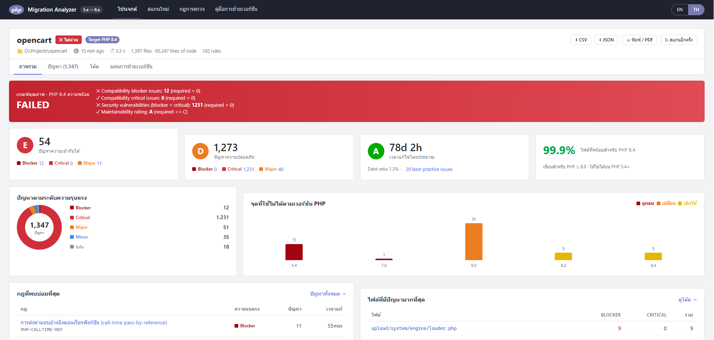

# PHP Migration Analyzer (PHP 5.x → 8.x)



A SonarQube-style static analyzer built with Node.js + Express and a web dashboard. It scans every file in a PHP project and reports:

- **Removed features**: `mysql_*`, `ereg`, `mcrypt`, `each()`, `create_function()`, PHP 4 constructors, `$HTTP_*_VARS`, `preg_replace /e`, ASP tags…
- **Behavior changes**: PHP 8 string/number comparison, concatenation precedence, uniform variable syntax, nested ternaries…
- **Deprecations up to PHP 8.5**: dynamic properties, `utf8_encode`, `"${var}"`, implicit nullable types, `strftime`…
- **Config**: removed `php.ini` / `.htaccess` directives, `composer.json` PHP constraints, abandoned or outdated packages
- **Security**: SQL injection, XSS, file inclusion, command injection, `unserialize` of user input, weak password hashing…
- **Best practices**: PSR-12 visibility, `var`, `global`, short arrays, `??`, `str_contains`, debug output…

Each issue includes severity, the PHP version where the feature changed, an effort estimate and a fix guide with before/after code.

## Run

**Windows:** double-click `install.bat` once to install dependencies, then `start.bat`
**Linux / macOS:** run `./install.sh` once, then `./start.sh`

The scripts check that Node.js is installed, run `npm install` on first start, start the server and open the browser at http://localhost:3000. To use another port, set `PORT` first: `set PORT=8080` (Windows) or `PORT=8080 ./start.sh`.

Or start it manually:

```bash
npm install
npm start            # http://localhost:3000
```

1. Open **New scan**.
2. Enter a project folder (or upload a `.zip`) and choose the target PHP version.
3. Review the results:
   - **Overview**: quality gate, A–E ratings, effort, readiness %
   - **Issues**: filters by severity, type, PHP version, rule and folder
   - **Code**: source view with inline issues
   - **Migration roadmap**: step-by-step upgrade plan
4. Export the report as CSV or JSON, or print it to PDF.

Try **"Try the sample project"** to scan `samples/legacy-shop`.

Environment variables: `PORT` (3000), `HOST` (127.0.0.1, so the app is only reachable from this machine), `DATA_DIR` (./data), `MAX_ZIP_MB` (500).

## CLI / CI

```bash
node cli.js /path/to/project --target 8.4                 # console report
node cli.js ./app --format json --out report.json
node cli.js ./app --fail-on critical                      # exit 1 when blocker/critical issues exist
```

## How it works

- `src/lexer.js`: a lightweight PHP tokenizer. It produces "views" of each file (code only, code + strings, strings only), so rules don't fire inside comments or string literals.
- `src/rules.js`: the rule catalog (regex rules plus structural checks for classes and function signatures).
- `src/scanner.js`: walks the project, applies the rules for the chosen target version, and computes the summary, ratings and quality gate.
- `test/run.js`: rule tests (`npm test`).

Static analysis can't catch everything. For example, passing `null` to internal functions (deprecated in 8.1) or calling non-static methods statically only shows up at runtime. Pair this tool with Rector, PHPCompatibility, PHPStan, and tests run on the target PHP version.
